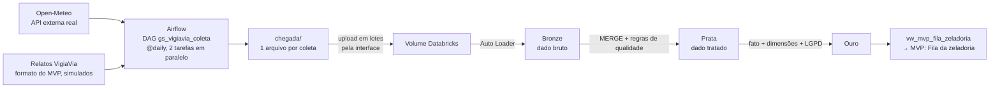

# VigiaVia — Pipeline de Dados (Big Data Architecture & Data Integration)

> FIAP Global Solution 2026.2 · CitizenTech · Engenharia de Software 4º ano (4ES)
> Disciplina **Big Data Architecture & Data Integration** · Componente **Dados** do MVP VigiaVia
> MVP no ar: https://ca-vigiavia-prod.happywave-0bf5b4c3.brazilsouth.azurecontainerapps.io · Repositório do MVP: https://github.com/akiramrt/vigiavia-mvp

| Integrante | RM |
|---|---|
| Deivison Pertel | 550803 |
| Eduardo Akira Murata | 98713 |
| Wesley Souza de Oliveira | 97874 |

## O produto e as perguntas que o MVP responde

**VigiaVia** detecta buracos nas vias com as câmeras que já circulam pela cidade e entrega à zeladoria um relato único,
georreferenciado e priorizado por buraco (piloto: Bela Vista, centro de São Paulo). Este repositório é o **pipeline de dados**
que coleta, trata e entrega ao MVP o que o cidadão e o agente da zeladoria veem. Ele responde:

1. Qual é a fila da zeladoria hoje, por severidade e status? (C1)
2. Onde estão os pontos mais críticos? (C2)
3. A chuva antecede mais relatos? (C3)
4. As detecções do modelo são confiáveis? (C4)
5. **Impacto:** quantos chamados duplicados o produto evita? (C5)

## Arquitetura



O Databricks Free Edition não se conecta ao Airflow, por isso os arquivos de `chegada/` sobem ao Volume pela interface, em lotes.

## Fontes de dados

| Fonte | Origem | Formato | Frequência | Observação |
|---|---|---|---|---|
| Clima (chuva, temperatura) | **Open-Meteo** (API pública, sem chave) | JSON, listas horárias | diária | externa e real; chuva é gatilho de buracos |
| Relatos do VigiaVia | gerador no formato do MVP | JSON, array de relatos | diária | **simulados** (`origem_dado = demonstracao`); geração determinística e justificada em `dags/vigiavia_fontes.py` |

Os relatos trazem, de propósito, 3 registros sujos por dia (coordenada nula, severidade inválida, linha repetida) para exercitar a qualidade.

## Estrutura do repositório

```
dags/        gs_vigiavia_coleta.py (DAG) · vigiavia_fontes.py (fontes e simulador)
databricks/  00_setup.sql · 01_bronze.py · 02_prata.py · 03_ouro.py · 04_consultas.sql
amostras/    um pouco de cada fonte (SINTÉTICAS, ver abaixo)
scripts/     gerar_amostras.py
docs/        relatorio_roteiro.md · contrato_mvp.md
```

> **Sobre `amostras/`:** foram geradas por `scripts/gerar_amostras.py`. O clima ali é **sintético** (mesmo formato do Open-Meteo)
> para testar sem internet. Os dados reais vêm do DAG. Para o relatório, substitua por arquivos coletados pelo Airflow.

## Como reproduzir

### 1) Coleta (Airflow 3)
```bash
pip install -r requirements.txt
export AIRFLOW_HOME=$PWD/airflow_home
export AIRFLOW__CORE__DAGS_FOLDER=$PWD/dags
airflow standalone            # UI em http://localhost:8080
```
Na UI: ative a DAG `gs_vigiavia_coleta`. Com `catchup=True` ela coleta os dias desde 01/11/2026. Os arquivos caem em `chegada/clima/` e
`chegada/relatos/`, com a data no nome. **Variables** (Admin → Variables), todas opcionais e fora do código:
`VIGIAVIA_CHEGADA_DIR`, `VIGIAVIA_ALERTA_URL` (webhook de notificação de falha), `OPENMETEO_API_KEY` (só plano comercial).

*Sem Airflow:* `python scripts/gerar_amostras.py --dias 5` cria arquivos equivalentes em `amostras/`.

### 2) Databricks (Free Edition)
1. Importe os notebooks de `databricks/` e rode `00_setup.sql` (schema `workspace.gs` e Volume `chegada`).
2. **Lote 1:** suba ao Volume (Catalog → `workspace.gs.chegada` → Upload) `clima/` e `relatos/` dos dias 01 a 03.
3. Rode `01_bronze` e anote as contagens. **Lote 2:** suba os dias 04 e 05, rode `01_bronze` de novo (só os novos entram) e mais uma vez (nada muda).
4. Rode `02_prata` (tratamento, MERGE e `prata_qualidade_log`).
5. Rode `03_ouro` informando o widget `sal` (texto secreto, **não** o versione) e depois `04_consultas.sql`.

## Requisitos da disciplina → onde estão

| Req. | Atendimento | Arquivo |
|---|---|---|
| 01 | 2 fontes, 1 API pública externa (Open-Meteo) | `dags/vigiavia_fontes.py`, `dags/gs_vigiavia_coleta.py` |
| 02 | DAG agendado grava 1 arquivo por coleta, com a data no nome, em `chegada/` | `dags/gs_vigiavia_coleta.py` |
| 03 | 2 tarefas em paralelo + `conferir_chegada`; chaves em Variables | `dags/gs_vigiavia_coleta.py` |
| 04 | 2 lotes de dias diferentes enviados ao Volume | passo 2 e 3 acima |
| 05 | Bronze com Auto Loader (`cloudFiles`, `availableNow`, checkpoint): só novos, sem duplicar | `databricks/01_bronze.py` |
| 06 | Prata: tipos, nulos/inválidos, MERGE pela chave, 3+ regras com contagem (`prata_qualidade_log`) | `databricks/02_prata.py` |
| 07 | Ouro: `fato_relato`, `fato_clima_dia`, `dim_data`, `dim_local`, `dim_relator` + 5 consultas (C5 de impacto) | `databricks/03_ouro.py`, `04_consultas.sql` |
| 08 | LGPD na Ouro (hash com sal + coordenada generalizada) e contrato com o MVP | `03_ouro.py`, `docs/contrato_mvp.md` |
| 09 | Este README | `README.md` |

## LGPD

* **Minimização:** só lat/lon, severidade, status e identificador pseudônimo do aparelho; nenhuma imagem, nome, e-mail ou telefone.
* **Pseudonimização:** `id_relator` vira `sha2(sal + id_relator)` na Ouro; o sal é informado em execução e não está no repositório.
* **Generalização:** a Ouro guarda a localização em células de ~110 m (3 casas decimais), não a coordenada exata.
* **Segredos:** o repositório não contém chaves, senhas nem dados pessoais reais (os dados são simulados/públicos).

## Limitações (honestas)

* Os relatos são **simulados**; a relação chuva × relatos (C3) só faz sentido com relatos reais do MVP.
* A célula de ~110 m aproxima "o mesmo buraco"; a deduplicação do MVP pode usar outro critério e dar outro percentual em C5.
* A ligação Airflow → Databricks é manual (upload em lotes) por restrição do Free Edition.
* O pipeline foi escrito e a sintaxe do Python verificada, mas **ainda não foi executado no Airflow nem no Databricks**: rode os passos acima e confira os resultados antes de colar prints no relatório.

## Licença
Código sob AGPL-3.0, alinhado ao repositório do MVP. Dados do Open-Meteo: CC BY 4.0 (citar a fonte).
