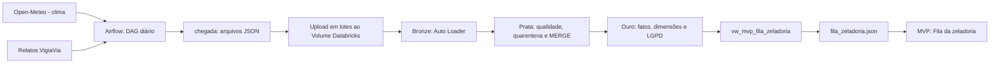

# VigiaVia — Pipeline de Dados (Big Data Architecture & Data Integration)

> FIAP Global Solution 2026.2 · CitizenTech · Engenharia de Software — 4º ano  
> Disciplina: Big Data Architecture & Data Integration

**MVP:** https://ca-vigiavia-prod.happywave-0bf5b4c3.brazilsouth.azurecontainerapps.io  
**Repositório do MVP:** https://github.com/akiramrt/vigiavia-mvp

## Integrantes

| Integrante | RM |
|---|---:|
| Deivison Pertel | 550803 |
| Eduardo Akira Murata | 98713 |
| Wesley Souza de Oliveira | 97874 |

## O produto

O VigiaVia apoia a identificação e priorização de buracos nas vias urbanas, consolidando relatos georreferenciados em uma fila de zeladoria. Este repositório contém o pipeline de dados que coleta, trata e disponibiliza dados analíticos ao MVP.

O MVP responde:
1. Qual é a fila da zeladoria por severidade e status?
2. Onde estão os pontos mais críticos?
3. Como os relatos se distribuem em relação à chuva?
4. Qual é a proporção de registros confirmados por origem?
5. Quantos chamados potencialmente duplicados a consolidação geográfica pode evitar?

## Arquitetura



O ambiente Databricks Free Edition não possui integração direta com o Airflow neste fluxo. Por isso, os arquivos gerados na pasta `chegada/` são enviados ao Volume pela interface, em lotes.

## Fontes

| Fonte | Origem | Formato | Frequência |
|---|---|---|---|
| Clima | API pública Open-Meteo | JSON com séries horárias | Diária |
| Relatos | Dados no contrato do VigiaVia; consultar metadados dos arquivos efetivamente utilizados | JSON (array de objetos) | Diária / lotes |

**Atenção à proveniência:** a implementação em `dags/vigiavia_fontes.py` atualmente descreve a geração de relatos como demonstrativa (`origem_dado = demonstracao`). A documentação anterior também descrevia as amostras da pasta `amostras/` como sintéticas. Se os arquivos atualmente versionados em `amostras/` forem coletas reais, atualizar esta seção e a origem dos dados somente após conferir os próprios arquivos, metadados e evidência de coleta. Não misturar amostras sintéticas com dados reais sem identificação.

## Estrutura

```text
dags/        DAG gs_vigiavia_coleta.py e módulo vigiavia_fontes.py
databricks/  00_setup.sql, 01_bronze.py, 02_prata.py, 03_ouro.py, 04_consultas.sql
amostras/    amostras de clima e relatos; identificar origem e período de cada arquivo
scripts/     geração de amostras para testes
docs/        relatorio_roteiro.md e contrato_mvp.md
```

## Camadas do Lakehouse

- **Bronze:** Auto Loader (`cloudFiles`) com `availableNow` e checkpoints separados para clima e relatos. A tabela registra arquivo de origem e horário de carga.
- **Prata:** conversão de tipos, tratamento de nulos/inválidos, quarentena, log de qualidade e `MERGE` pelas chaves de cada fonte.
- **Ouro:** fatos `fato_relato` e `fato_clima_dia`, dimensões `dim_data`, `dim_local` e `dim_relator`, além de view para consumo pelo MVP.

## LGPD

- Minimização: a Ouro não precisa armazenar imagens, nome, e-mail ou telefone.
- Pseudonimização: identificador do relator transformado por SHA-256 com sal; o sal é fornecido na execução e não deve ser versionado.
- Generalização espacial: coordenadas arredondadas a três casas decimais na dimensão local (aproximadamente 110 m).
- O JSON de saída para o MVP não deve conter identificador original do relator nem coordenadas exatas.

## Requisitos da disciplina

| Requisito | Implementação |
|---|---|
| 01 — Fontes | Open-Meteo e relatos do VigiaVia |
| 02 — DAG agendado | `dags/gs_vigiavia_coleta.py` |
| 03 — Paralelismo e conferência | tarefas paralelas e `conferir_chegada`; configurações via Airflow Variables |
| 04 — Dois lotes | upload de arquivos de dias distintos ao Volume |
| 05 — Bronze incremental | `databricks/01_bronze.py` |
| 06 — Prata e qualidade | `databricks/02_prata.py` e tabela `prata_qualidade_log` |
| 07 — Ouro e SQL | `databricks/03_ouro.py` e `databricks/04_consultas.sql` |
| 08 — LGPD e MVP | `docs/contrato_mvp.md` e view `vw_mvp_fila_zeladoria` |
| 09 — Documentação | este README e `docs/relatorio_roteiro.md` |

## Como reproduzir

### Airflow 3

```bash
pip install -r requirements.txt
export AIRFLOW_HOME=$PWD/airflow_home
export AIRFLOW__CORE__DAGS_FOLDER=$PWD/dags
airflow standalone
```

Na interface, ativar `gs_vigiavia_coleta`. Configurar as Airflow Variables necessárias ao ambiente. O DAG cria arquivos datados em `chegada/clima/` e `chegada/relatos/`.

### Databricks Free Edition

1. Importar os notebooks de `databricks/` e executar `00_setup.sql`.
2. Enviar o primeiro lote de arquivos ao Volume `workspace.gs.chegada`.
3. Executar `01_bronze.py` e registrar contagens.
4. Enviar o segundo lote, executar novamente e comparar as contagens; executar uma terceira vez sem arquivos novos para demonstrar idempotência.
5. Executar `02_prata.py` e conferir `prata_qualidade_log` e tabelas de quarentena.
6. Executar `03_ouro.py`, fornecendo o widget `sal` sem versioná-lo.
7. Executar as cinco consultas de `04_consultas.sql` e registrar resultados reais no relatório.

## Execução e evidências

A equipe informa que executou Airflow, Bronze, Prata, Ouro e as cinco consultas, e que o MVP está disponível. Inserir no relatório os prints correspondentes, datas de execução, contagens reais da Bronze, contagens por regra da Prata e resultados numéricos das consultas. Não registrar números estimados.

## Limitações e cuidados de interpretação

- A relação entre chuva e relatos não deve ser apresentada como causalidade sem análise adequada e dados representativos.
- A consolidação por célula geográfica de aproximadamente 110 m é uma aproximação analítica; pode diferir da regra de deduplicação aplicada pelo MVP.
- No ambiente Free Edition, a transferência dos arquivos do Airflow para o Volume é manual.
- Identificar claramente se cada conjunto de relatos é real, demonstrativo ou sintético.

## Licença e atribuição

Manter as informações de licença do repositório e atribuir a fonte Open-Meteo conforme os termos aplicáveis. Não publicar segredos, tokens, senhas, sal de hash ou dados pessoais reais.
